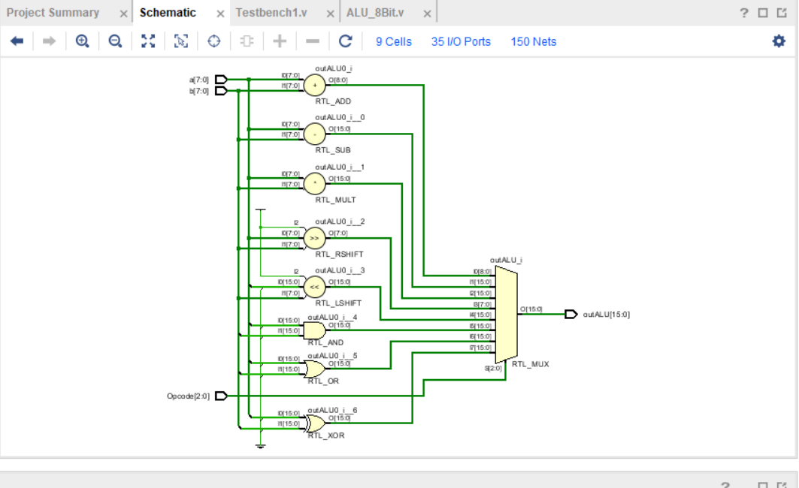
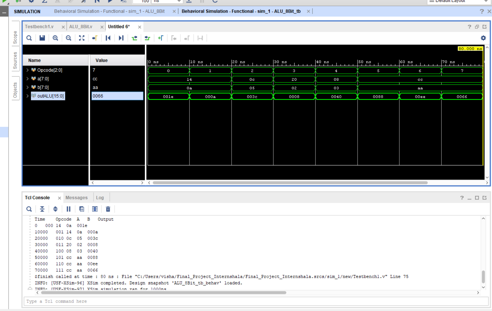
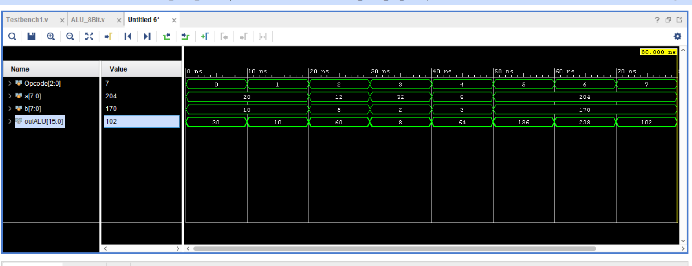
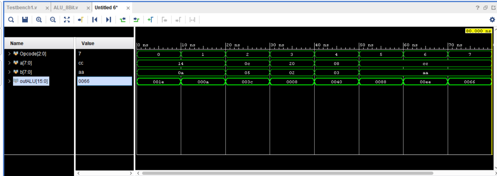

# 8-Bit Arithmetic Logic Unit (ALU) Design Using Verilog

<p align="center">

**A Combinational ALU Design and Functional Simulation Project**



</p>

---

## Overview

This project implements an **8-bit Arithmetic Logic Unit (ALU)** using Verilog HDL. The design performs arithmetic, logical, and bit-shifting operations on two 8-bit input operands based on a 3-bit opcode.

The ALU produces a 16-bit output to accommodate the results of arithmetic operations, particularly multiplication.

## Key Specifications

| Parameter | Specification |
|:---|:---|
| Design Type | Combinational Logic |
| Hardware Description Language | Verilog HDL |
| Operand Width | 8-bit |
| Opcode Width | 3-bit |
| Output Width | 16-bit |
| Number of Operations | 8 |
| Design Module | `ALU_8Bit` |

## Supported Operations

The ALU supports eight operations selected through the 3-bit opcode.

| Opcode | Operation | Description |
|:---:|:---|:---|
| `000` | ADD | Addition of two operands |
| `001` | SUB | Subtraction of two operands |
| `010` | MUL | Multiplication of two operands |
| `011` | SHR | Logical right shift |
| `100` | SHL | Left shift |
| `101` | AND | Bitwise AND |
| `110` | OR | Bitwise OR |
| `111` | XOR | Bitwise XOR |

## Design Architecture

The design uses a combinational `always @(*)` block with a `case` statement to decode the opcode and select the corresponding operation.

### Input Signals

- **Opcode [2:0]:** Selects the ALU operation.
- **a [7:0]:** First operand.
- **b [7:0]:** Second operand.

### Output Signal

- **outALU [15:0]:** Stores the result of the selected operation.

## Simulation and Verification

The design includes a Verilog testbench to apply different input combinations and observe the corresponding ALU outputs.

### Simulation Result

<p align="center">

</p>

### Waveform Analysis

**Waveform 1**

<p align="center">

</p>

**Waveform 2**

<p align="center">

</p>

## Repository Structure

```text
Verilog-8bit-ALU/
│
├── src/
│   └── ALU_8Bit.v
│
├── rtl/
│   └── rtl_schematic.png
│
├── testbench/
│   └── Testbench1.v
│
├── simulation/
│   ├── Simulation_result.png
│   ├── Waveform1.png
│   └── Waveform2.png
│
├── README.md
├── LICENSE
└── .gitignore
```

## Tools and Technologies

- **Verilog HDL** – RTL design
- **Xilinx Vivado** – HDL simulation and design environment

## Learning Outcomes

- Understanding combinational logic design using Verilog.
- Implementing arithmetic and logical operations in RTL.
- Using opcode-based operation selection.
- Understanding Verilog testbench development.
- Analyzing simulation waveforms and RTL schematics.

## References and Attribution

This project is maintained as an educational RTL design project.

Original reference: [8-bit ALU Verilog – VishalRoy08](https://github.com/VishalRoy08/8-bit-ALU-Verilog).

Please refer to the included LICENSE file for applicable reuse and redistribution terms.

---

<p align="center">

**8-Bit ALU | Verilog HDL | Digital Design**

</p>
